

  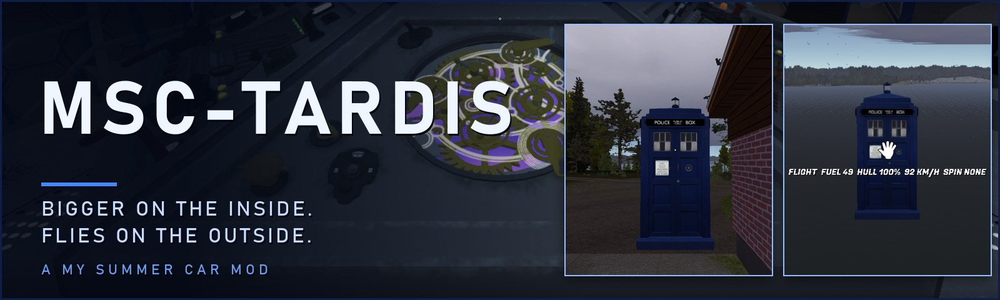

  
  
  
  

  
  
  

<h1 align="center">MSC-TARDIS</h1>

<b>A police box stands in your yard. Step inside: it is far bigger than it looks, it has a flight console, and it flies.</b>

---

## Contents

- [About](#about)
- [Features](#features)
- [Screenshots](#screenshots)
- [Requirements](#requirements)
- [Installation](#installation)
- [How to play](#how-to-play)
  - [Getting in and out](#getting-in-and-out)
  - [The console](#the-console)
  - [Travelling](#travelling)
  - [Piloting by hand](#piloting-by-hand)
  - [Fuel, hull, HADS and repair](#fuel-hull-hads-and-repair)
  - [The three interiors](#the-three-interiors)
  - [The guidebook](#the-guidebook)
  - [Saving](#saving)
- [Known issues](#known-issues)
- [Troubleshooting](#troubleshooting)
- [Uninstalling](#uninstalling)
- [Reporting problems](#reporting-problems)
- [Credits](#credits)

## About

MSC-TARDIS adds a working TARDIS to My Summer Car. It appears in your home yard on a new load. Walk in through the door
and you are in a huge room with its own lighting, a glowing time rotor and a flight console. Pull a lever and the box
dematerialises, flies through the vortex and lands somewhere else in Peräjärvi. Or take the controls and fly it yourself.

## Features

- **A real TARDIS exterior** that stands in the home yard on a new load. It has a lit lamp, opening doors, a sign and a
  hull that smokes when it's damaged.
- **Bigger on the inside.** The door takes you into a separate room with its own lighting, a central time rotor and a
  working flight console.
- **Three interiors, switchable in game:** a custom organic-coral hall, a full Toyota-style console room with 260 meshes, and
  the copper-and-green 2010 console room, all with animated controls and screens.
- **Instant travel** to the home yard, Peräjärvi or Teimo's shop, or to any coordinates you dial in. You fly through a
  vortex and materialise at the other end, and a lake landing floats at the surface.
- **Fly it yourself.** Take the controls, leave the ground, hover, boost, spin and drop a destination marker anywhere on
  the map.
- **Ship systems:** artron fuel, hull health, a stability rating that decides how close you land, HADS (the box escapes
  when it's attacked), a repair cycle, door locks and a power switch.
- **Real sound:** recordings for take-off, flight, landing, the doors, alarms, power and the handbrake.
- **The TARDIS guidebook:** a navy leather book with the police box doors on its cover. It lies on the console, and you
  pick it up, carry it, drop it and throw it like the game's notepad.
- **It remembers.** Where the box stands, whether you were inside, and every console setting are kept in the game's own
  save.

## Screenshots

<table>
  <tr>
    <td width="50%">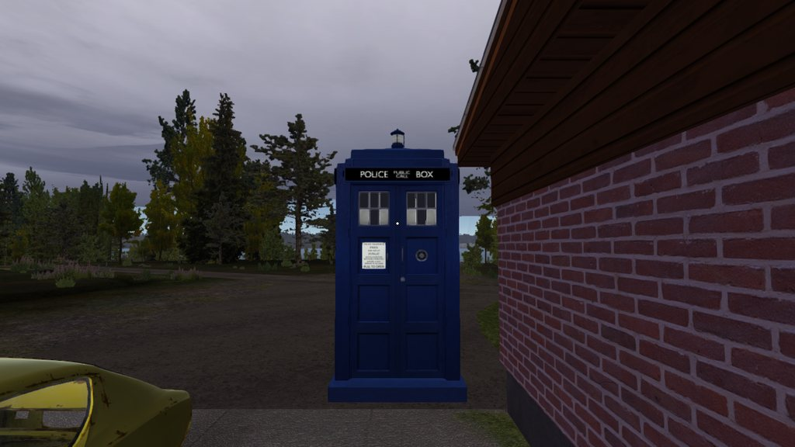 <b>Home yard.</b> The box where you left it.</td>
    <td width="50%">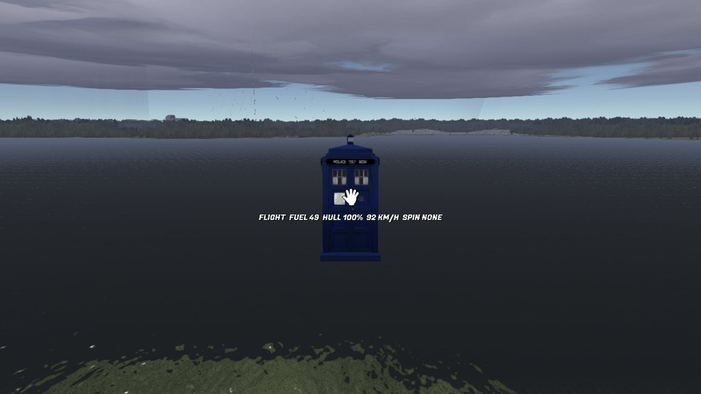 <b>In flight.</b> Piloted over the lake, with the flight readout.</td>
  </tr>
  <tr>
    <td width="50%">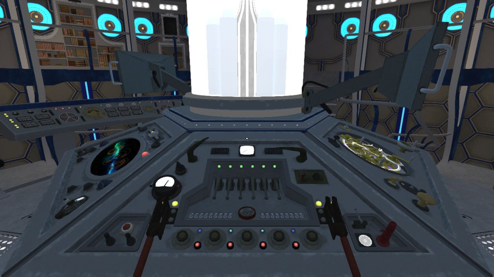 <b>Toyota console.</b> Every control sits where the original puts it.</td>
    <td width="50%">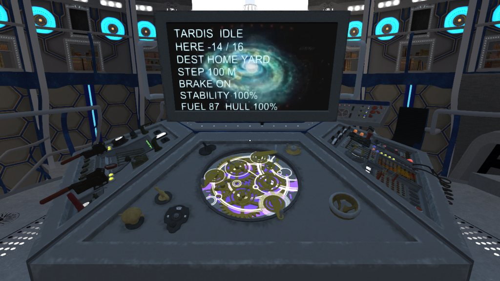 <b>Monitor.</b> Destination, step, brake, stability and fuel.</td>
  </tr>
  <tr>
    <td width="50%">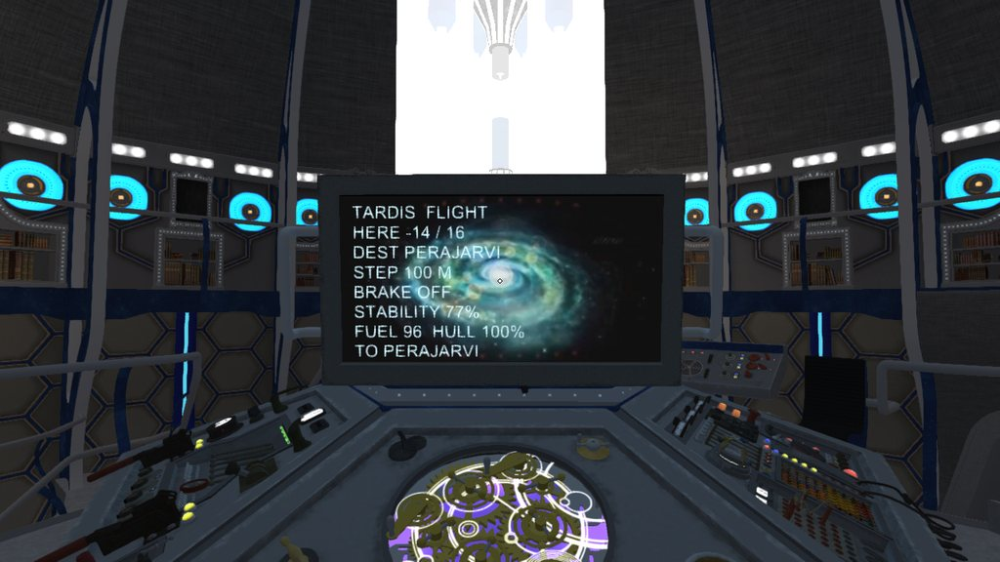 <b>Under way.</b> The monitor follows the flight state.</td>
    <td width="50%">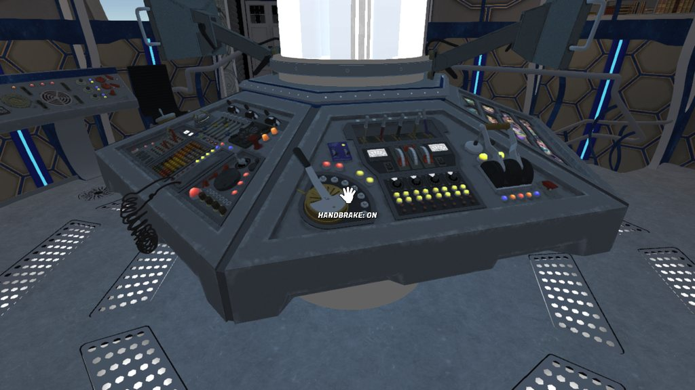 <b>Controls you use.</b> Look at one and press Use.</td>
  </tr>
  <tr>
    <td width="50%">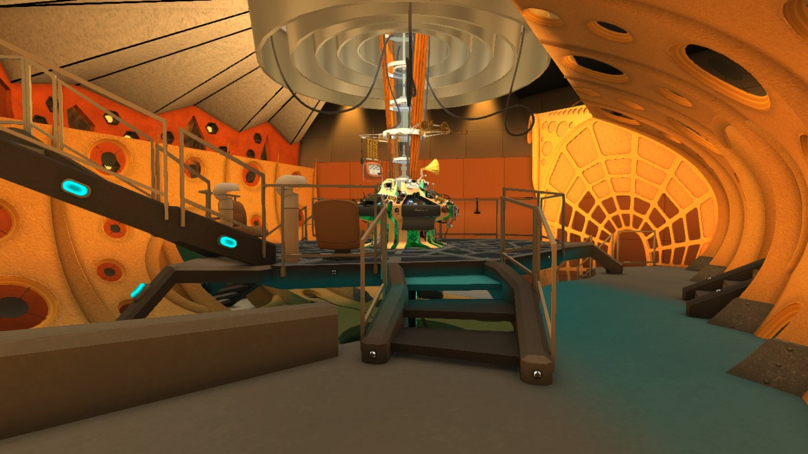 <b>2010 room.</b> Amber walls, the stair and the console, seen from the door.</td>
    <td width="50%">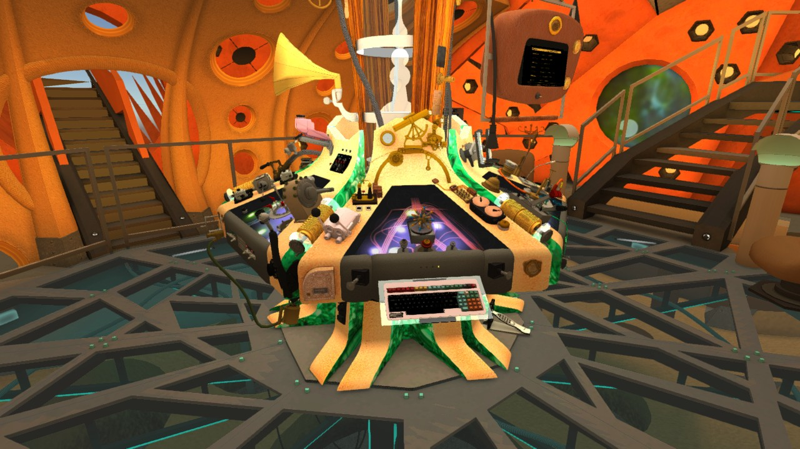 <b>2010 console.</b> Levers, dials and the monitor, over a glass floor lit teal from below.</td>
  </tr>
  <tr>
    <td width="50%">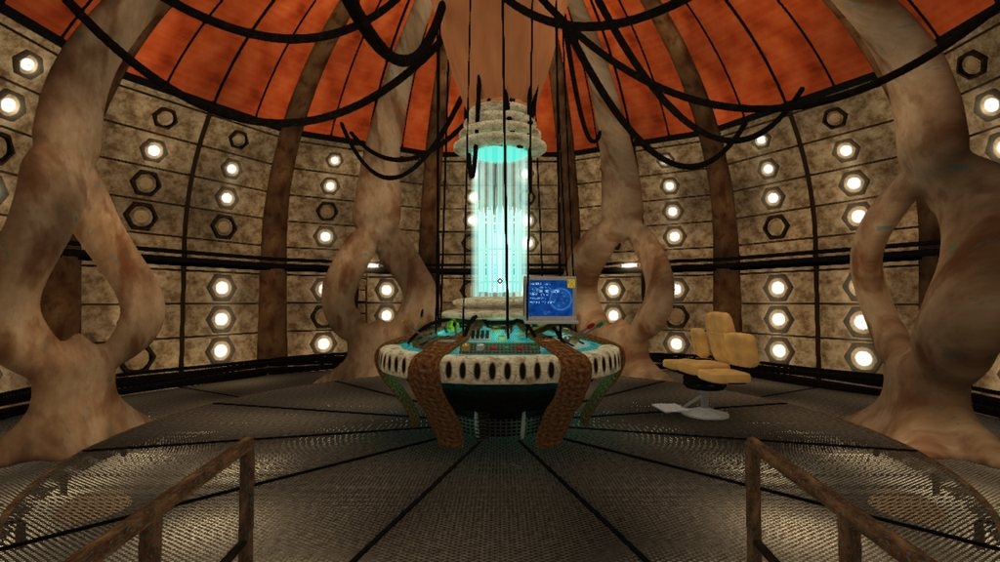 <b>Custom interior.</b> Roundels, coral pillars and the time rotor.</td>
    <td width="50%">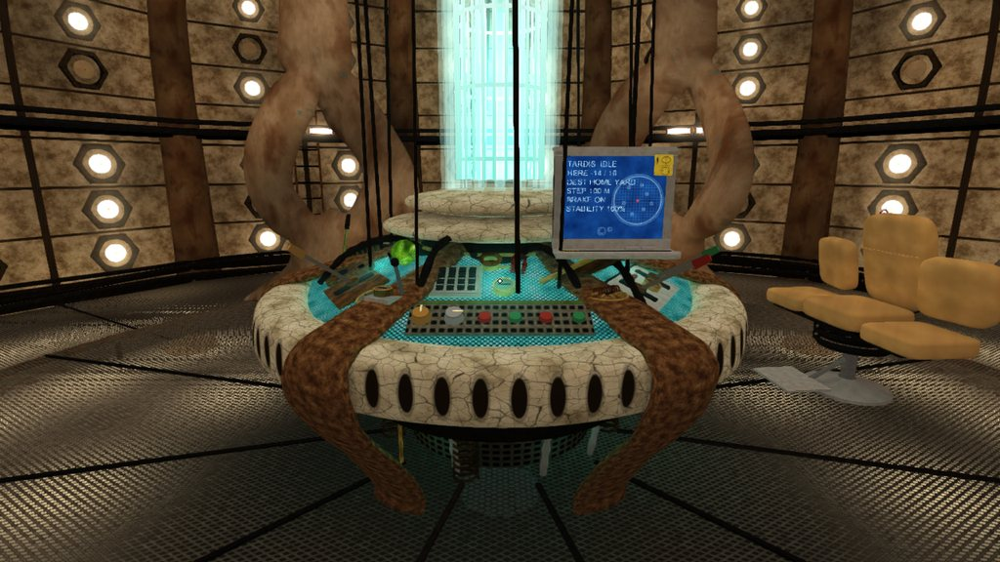 <b>Custom console.</b> With a seat, a monitor and the panels.</td>
  </tr>
</table>

## Requirements

- **My Summer Car** on Windows.
- **[MSCLoader](https://github.com/piotrulos/MSCModLoader)**, installed into the game.

## Installation

1. Install [MSCLoader](https://github.com/piotrulos/MSCModLoader) into My Summer Car, if you haven't already.
2. Unzip the download into the game's `Mods` folder. It holds `MscTardis.dll` and an `Assets/MscTardis/` folder, which end
   up as `Mods/MscTardis.dll` and `Mods/Assets/MscTardis/`.
3. Start the game, load a save, and look for the box in the home yard.

The mod adds itself to an existing save. It needs no new game and no settings.

## How to play

### Getting in and out

Look at the police box's door from within 2.5 m and press **Use**: the doors swing in, and the console room shows in the doorway.
Walk through it. There is no loading screen and no fade. Inside, the same doors stand open into the room and show the world
where the box stands, and you walk out the same way.

The doors stay open until someone shuts them: press Use on either door again, or use the console's **Door** switch. They can't
be shut while you stand in the doorway, and they won't open in flight, during a repair or while locked. The box won't take off
with them open. The box's position is saved with the game, so it stays where you left it.

### The console

Look at any control and press **Use**. Without power, only POWER, REPAIR and the door lock work.

| Control | What it does |
|---|---|
| **Selector** dial | (Toyota: the big knob on the right of the console.) Picks the destination: home yard, Peräjärvi, Teimo's shop, or MANUAL coordinates. |
| **Step** dial | Sets how far the coordinate buttons move the manual target: 10, 100 or 1000 m. |
| **BIAS, DRIFT, PHASE, OFFSET** knobs (coral) | Nudge the manual target X−, X+, Z−, Z+ by one step per turn. The first turn switches the selector to MANUAL, starting from where the box stands. On the Toyota console they are the row of five knobs by the switch board (the fifth is a spare). On the 2010 console they are the five red-spiked steering levers in the middle of one panel: BIAS and DRIFT on the left, PHASE and OFFSET on the right, a spare in the middle. |
| **Keypad** | All 16 keys, 1–0 and A–D, are for entering a [protocol](#protocols). `#` sends the entry, `*` clears it. On the Toyota console it is a block of 16 keys in the middle of the keyboard grid, with their characters written on the caps. On the 2010 console it is the typewriter: the 16 keys in the middle of it carry the keypad's characters. |
| **Switch board** | MASTER, CIRCUIT 1–6 and BREAKER 1–6 are the [subsystems](#subsystems)' switches; CIRCUIT 7–10 and RELAY 1–5 are for [taking off](#taking-off). On the Toyota console they are the two banks of small switches (MASTER, CIRCUIT 1–6; BREAKER 1–6), the six flat switches (CIRCUIT 7–10) and the toggles, sliders, buttons and flippers (RELAY 1–27: every lever, slider and button of each bank works, including the ones the original model leaves still). The cranks, levers and other loose hardware on the console are spare switches (named like ARTRON SHUNT) that the flight minigame asks for. The red dot on each of the five pill buttons is a lamp that lights with its button. The 2010 console has rows of small switches along the padded rails at the front of three panels: MASTER and CIRCUIT 1–6 on one, BREAKER 1–6 on the one facing the doors, and CIRCUIT 7–10 and RELAY 1–5 either side of the plaque on the throttle's panel. Its own hardware (toggles, valves, cranks, dipsticks, pinball plungers, the pump, the engine release lever, the quantum foam manipulators, the pedals) is RELAY 6–30 and spare switches, which the flight minigame asks for. |
| **Handbrake** lever | Must be off before take-off or free flight. While it's on, it also recharges the fuel. |
| **Take-off** lever (the throttle) | Starts the flight to the selected destination. On the coral console it's the black crank lever beside the monitor: throw it over the top. |
| **Stabiliser** lever | Restores stability, which drops in flight. |
| **Power** lever | Switches the box on or off. Off, the room dims and everything but POWER, REPAIR and the lock stops. On the Toyota console it is the coral console's guarded switch: lift the cover, flip the switch, and close the cover again once it is off. |
| **Console lamps** (Toyota) | The lamps are indicators, and dark without power. The five by the power switch are POWER (blue), INDICATOR 2 (orange, master off) and INDICATOR 1 (red, a fault). A lamp by each switch shows it. The two rows of eight on the front rim are the hull and the stability. The four by the selector show its position, and the throttle's two light when the box is ready to take off. The lamps round the keypad light while a code is asked for, and the ones between the knobs flash when a nudge is used. |
| **Console lamps** (coral and 2010) | Dark without power, like the Toyota's. On the coral console a lamp under each CIRCUIT rocker and MASTER and over each BREAKER shows that switch; the door, lock and autopilot switches and the FLIGHT row have one to the right of each; two bars of eight over the FILTER and BFO switches are the hull (green) and the stability (teal); four over the selector show its position; two in the keypad's top margin light while a code is asked for; and two on the strut in front of the throttle light when the box is ready to take off. On the 2010 console every rail switch has a lamp over it, POWER and INDICATOR 1 and 2 sit after MASTER's row, the hull and stability bars are on the rail under the monitor, the selector's four over its keyboard and the keypad's two beside the typewriter; the throttle's own lights are READY, the four green lamps by the stabiliser are the stability, and the red lamps round the top flash on a fault or a flight coming apart. The red button by the plotter (SWITCH 13) lights when on, and the bell by the power switch (SWITCH 14) rings. On every console a switch's lamp blinks when the flight minigame or a protocol challenge asks for it. |
| **Pilot** lever | Takes the controls for hand flying. |
| **Flight** switch | Turns free flight on or off. On the coral console it's the first toggle beside the stabiliser wheel. |
| **Float** lever | Turns hover on or off. |
| **Spin** dial | Sets the box's spin direction in flight: none, clockwise or anticlockwise. |
| **Door** button | Opens or shuts the doors, the same as Use on the doors themselves. Won't open in flight or while locked. |
| **Lock** button | Locks the door, so nobody can enter or leave. |
| **HADS** switch | The **autopilot** switch (see [Taking off](#taking-off)). |
| **Fast return** button | **Protocol cancel**, which turns off the latest protocol. |
| **Repair** button | Primes a repair. See [below](#fuel-hull-hads-and-repair). |

The monitor shows the computer's screen: the page it was left on, kept live (so STATUS follows the flight). When something needs
attention it switches to a short readout instead: a flight prompt, a protocol being keyed in or running, or no power.
On the coral console, **look at the keyboard on the plate under the monitor and press Use or click**: the view turns to the monitor, your
movement and look are held and the computer runs live on the monitor. The keyboard is the only way in there. The Toyota and 2010 rooms
have no keyboard: look at the monitor's screen and press Use or click to open the computer as an overlay.

### The computer

Look at the keyboard (coral console) or the monitor screen (Toyota and 2010) from within 2.6 m and press **Use** or click. It needs
power and isn't available while piloting or seated, and your own movement and look are held. On the coral console the pages show on
the monitor; in the other rooms a CRT-style screen comes up over the game.
The game keeps running behind it. Up/Down (or W/S) select, Enter opens, Left/Right change a setting, Backspace goes back (and
logs out from the main menu), Page Up/Down scroll, and Use or Esc closes it. The mouse works too: the **wheel** moves the
selection (or scrolls a page of text), a **click** does what Enter does, and a **right click** goes back.

| Page | What it does |
|---|---|
| **Status** | State, location, destination, handbrake, power, bars for stability, artron and hull, HADS, doors, flight, float, spin, interior. Right shows the take-off checklist and alerts: the flight prompt, faults, active protocols, the locator and the scan report. |
| **Navigation** | Picks a preset destination (the selector dial follows). Coordinates, step and presets stay on the console. |
| **Subsystems** | Health, breaker, circuit and state of the six systems, and what to do next. |
| **Protocols** | Every protocol with its ID, whether it's active or available, and what it does. |
| **Scanner** | The exterior camera, while the exterior scanner protocol is on. Left/Right turn the view. |
| **Settings** | Difficulty (EASY or ADVANCED), the screen colour (green, amber, white) and the key tick. Saved with the game. |
| **Reference** | The controls, flying, piloting keys, power and repair, protocols and subsystems. |

### Subsystems

Six systems run the box: Navigation, Dematerialisation, Shields, Chameleon, Telepathic and Life support. On the coral console's
**switch board** the bat lever is **MASTER**, and the first six rockers of the top row are **CIRCUIT 1–6** and of the middle row
**BREAKER 1–6**. A system works when MASTER, its circuit and its breaker are on and it hasn't failed. Damage trips its breaker:
reset it by hand. Below 40% health a system is damaged and half as good; below 10% it has failed and trips its breaker again until
the box is repaired. The two lamp buttons at the board's left are INDICATOR 1 (a fault) and 2 (MASTER off). The computer tells you
what to do; you do it on the console.

| System | When it is off, failed or damaged |
|---|---|
| Navigation | Presets refuse (manual coordinates only) and landing drift triples. Damaged: drift doubles. |
| Dematerialisation | Take-off refuses. Damaged: a half more fuel. |
| Shields | Hull damage doubles. Damaged: a half more. |
| Chameleon | Cloak refuses. |
| Telepathic | The telepathic jump and the locator refuse. |
| Life support | The room goes to emergency red, the cloister bell rings every 30 s, the hum stops, and your stress and fatigue rise while you are inside, to their limit in about three minutes. |

Hull damage spreads into a random subsystem, and a repair restores them all.

### Protocols

Type a protocol's ID on the keypad and press `#`. Some lit caps and push buttons on the switch board (RELAY 6–20 and the plain
push buttons) start flashing: press them all, in any order. You get 5 seconds, and every correct press adds 2 more, plus the time
to walk round to the next one (most on the Toyota and 2010 consoles, whose controls are spread further). A wrong button or running
out of time fails it, with no penalty. Entering an active protocol's ID again turns it off, and **protocol cancel** turns off the latest one. The longer the
ID, the more buttons.

| ID | Protocol | ID | Protocol |
|---|---|---|---|
| `1047` | Lights / ambience | `B1946` | Drift compensator |
| `2218` | Diagnostics scan | `B2051` | Stasis field |
| `3359` | Exterior scanner | `B3162` | Artron vent |
| `4081` | Beacon | `C1273` | Telepathic jump |
| `5126` | Locator | `C2384` | Tow beam |
| `6293` | Fault locator | `C3495` | Lightning siphon |
| `70418` | Fast return | `C4506` | Chameleon circuit |
| `A1507` | HADS | `1963114` | Lockdown |
| `A2614` | Shields | `D4D4217` | Siege mode |
| `A3728` | Cloak | `000001999` | Emergency Program One |
| `A4835` | Atmospheric shell | `DD0000666` | Self-destruct |
| `C5617` | Interior change | | |

The telepathic jump adds five named places to the selector; the locator gives the Satsuma's bearing and distance; the tow beam
brings the Satsuma beside the box; the stasis field freezes your hunger, thirst and the rest while you're inside; the lightning siphon
recharges the artron fast in a thunderstorm; the atmospheric shell keeps rain off the box; Emergency Program One flies to the home
yard; Self-destruct counts down 60 s to the end of the hull and can be cancelled. The chameleon circuit has no exterior patterns yet.

### Taking off

On the coral console the take-off lever refuses until the same steps are done every time: a destination set, the HANDBRAKE off,
MASTER on, CIRCUIT 7–10 on, the arm row (RELAY 1–5) lit, and the STABILISER worked to 80%. It says which step is missing, and the
computer's status page ticks them off. On **EASY** the AUTOPILOT switch does the arming steps for you; on ADVANCED it refuses.

### The flight minigame

A flight flown from the console is long, 70 to 120 seconds, and the console plays through it. The monitor names a control and how to work
it ("PRESS RELAY 14", for instance), and its cap or a halo flashes; a button's small red lamp blinks
too. Do it in time. A hit gives stability back and a miss or a wrong press takes it away; every third wrong press hurts the hull and a
system, and three misses in a row force an emergency landing. The pace picks up as the flight goes on, and from a fifth of the way a prompt
may be a run of two or three controls to work in order ("PRESS RELAY 13, THEN 1 MORE"). A control is not asked again until several others
have been, and the next is never worked the same way as the last where the console has a choice. EASY gives 6.5 s and the switch board's caps,
levers and spare switches; ADVANCED gives 4 s and any button, switch or knob. Stability also bleeds away slowly in flight: a turn of
the STABILISER wheel between prompts gives some back.

Spare controls go by plain numbered names (RELAY 14, SWITCH 9, SPARE LEVER 3). A few that stand out on their own have a name from the
show's lore instead: the coral room's cast lever (CHRONON GOVERNOR) and plunger (VORTEX INJECTOR), and on the Toyota console a spare knob, a
crank and two lone switches (HELMIC REGULATOR, TACHYON CRANK, ZEITON BYPASS, ARTRON SHUNT).

### Travelling

1. Turn the **handbrake** off.
2. Pick a destination with the **selector**, or dial in coordinates with the buttons.
3. Pull the **take-off** lever. The box dematerialises, flies through the vortex and materialises at the target.

Stay inside until it lands, then leave through the door at the new spot. Landing on the lake floats the box at the
surface, so you step out swimming.

**Stability** drops in flight. A low stability lands the box off target, up to 30 m away when it's piloted with no
stabilising at all. Use the stabiliser lever during the flight to bring it back up.

| Place | Where |
|---|---|
| Home yard | −14, 16 (the start) |
| Peräjärvi | −1422, 1145 |
| Teimo's shop | −1536, 1165 |
| Manual | Anywhere, by the coordinate buttons |

### Piloting by hand

Pull the **pilot** lever and the camera moves outside the box, orbiting it. Press **Use** to put the controls down.

| Key | Action |
|---|---|
| **R** | Free flight on or off (needs the handbrake off and some fuel) |
| **W / S** | Forward and back |
| **A / D** | Strafe left and right |
| **Space / Ctrl** | Up and down |
| **Shift** | Boost |
| **Alt + A / D** | Rotate left and right |
| **T** | Hover (float) on or off |
| **J** | Handbrake |
| **P** | Power |
| **Right mouse** | Cycle the spin |
| **Mouse / scroll** | Look around the box, and zoom |
| **H** | Place a destination marker. Move it with W/A/S/D, Space and Ctrl (Shift for faster, Alt+A/D to turn it), then press H or left-click to set it. |
| **Left mouse, hold and release** | Aim where the camera looks, and take off there. In the vortex, a left-click lands. |
| **Use** | Leave the controls |

### Fuel, hull, HADS and repair

- **Artron energy** is the fuel, from 0 to 100. A new box starts at a quarter. Travel, flight, boost, hovering and HADS all
  spend it, and it recharges slowly while the box is parked or hovering. A flat battery cuts the power.
- **Hull** starts at 3000. Below 40% it is damaged and smokes, and the cloister bell rings. Below 10% it is broken: it
  recharges slower and, at speed, flight turns unreliable and explodes. At zero it is destroyed, and the power goes off until
  it is repaired.
- **HADS**, when armed, makes a hit teleport the box to a random spot up to 300 m away, then bring it back after 10 to
  25 s. It needs power and fuel. Without them, you only get a warning.
- **Repair:** prime it from the console, leave the box, and it repairs itself with the doors locked, taking up to a minute.

### Beta consoles

The coral console is the finished one. The Toyota and 2010 consoles are still in beta, and are off by default: with **Enable beta
consoles** off in the mod's settings (MSCLoader's menu, the gear on the mod's card) the interior is always the coral console and
the interior change protocol is unavailable. Turn it on to switch to the other two. A save that was left in a beta room goes back
to the coral console when the interior is next built.

### The three interiors

The **interior change** protocol (`C5617`) switches rooms in place, while nothing else is going on. All three have the same controls, the same
monitor and the same flight.

- **Custom** is a coral-and-bronze hall with roundels, curved pillars and a time rotor, built for this mod.
- **Toyota** is a full console room: a hexagonal console with animated controls, a double monitor, phones, a scanner,
  hinged inner doors and walls of roundels.
- **2010** is the copper-and-green console room: a stepped platform of roundel walls and a spiral stair, a console with
  its gramophone, telephone and typewriter, a time rotor that rises and falls, a small monitor and a pair of hinged inner
  doors. Each control makes its own recorded sound.

### The guidebook

The TARDIS guidebook starts on the console, on the rim by the panel that faces the doors (in the Toyota and 2010 rooms, at
the front of the console). Pick it up, carry it and put it down anywhere, inside or out, as you would the notepad. It stays
where you leave it. If it falls out of the room or through the map, it goes back to the console, and switching interiors
takes it to the new room's console unless you're holding it.

### Saving

The mod stores its state in the game's own save, so it follows your save slot: where the box stands, whether you are inside,
the selector, manual coordinates and step, the handbrake, power, fuel, hull, HADS, the spin, the door state, which
interior you picked, the subsystems' health and the switch board's bus, circuits and breakers, the active protocols, the computer's settings, and where the guidebook is.

My Summer Car's saves are in `%USERPROFILE%\AppData\LocalLow\Amistech\My Summer Car`. Back them up before you try
anything risky: with permadeath on, a death deletes the save.

## Known issues

- **Toyota time rotor:** the glass column reads as solid white, and the rotor's rings don't move.
- **Toyota glass:** the `transparent` glass stays still while the pistons move.
- **Broken flight:** when the hull is broken, boost can push the speed far past the intended figure.
- **Not built yet:** the Toyota and 2010 rooms' inner corridors and extra interior doors. The 2010 room's side doors are closed panels.

## Troubleshooting

| Problem | Fix |
|---|---|
| No TARDIS in the yard | Check that MSCLoader is installed and that `MscTardis.dll` is in the game's `Mods` folder. |
| No sound, or a missing texture | The files in `Mods/Assets/MscTardis/` are missing or in the wrong folder. Copy them again. |
| The box doesn't take off | Check that the handbrake is off, that there is fuel, and that the power is on. |
| A control does nothing | With the power off, only POWER, REPAIR and the door lock work. The door also refuses to open in flight or while locked. |
| The player lands at the Peräjärvi churchyard | The landing spot was under the terrain. Dial in a spot nearby and try again. |
| Something else is wrong | The game writes a log to `output_log.txt` in its folder. Attach it to your report. |

## Uninstalling

Delete `MscTardis.dll` from the `Mods` folder, and the `Mods/Assets/MscTardis` folder. Your save still loads without the
mod.

## Reporting problems

Open an [issue](https://github.com/glizzy5oblin/msc-tardis/issues) and say what you did, which interior you were in, and
what happened. Add `output_log.txt` from the game folder if you can.

## Credits

- The console computer's lettering is rendered from [Cascadia Mono](https://github.com/microsoft/cascadia-code) by Microsoft,
  under the SIL Open Font License 1.1.
- Some textures were made or redrawn with generative models on [fal](https://fal.ai): the coral room's walls, pillars, dome,
  ceiling funnel, console rim and grit, seat and rug (nano-banana-2 edit from photographs of the set, and a SeedVR upscale), a few of
  the console's controls such as the glass orb, the gear wheel and a bakelite plate (nano-banana-2 and nano-banana-pro edit), and the
  mod's icon.
